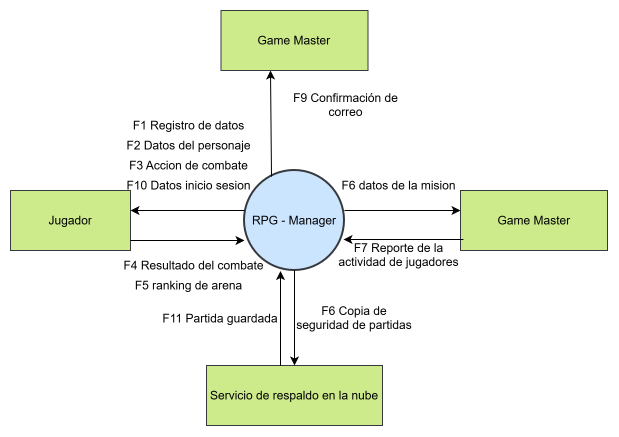
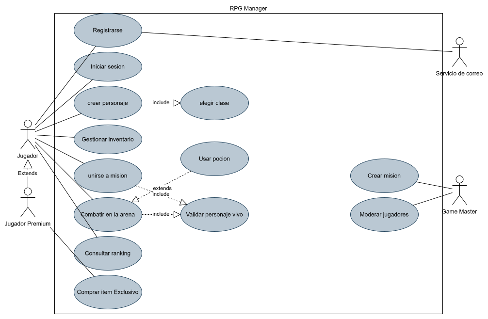
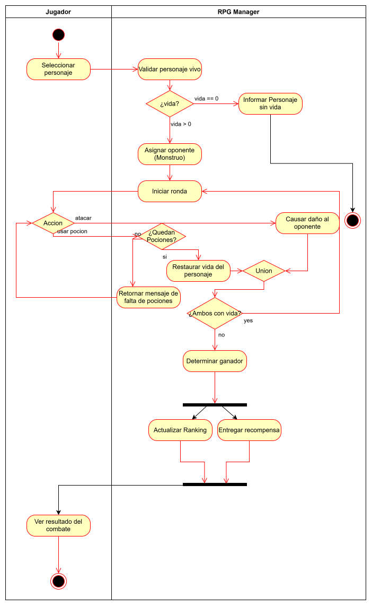
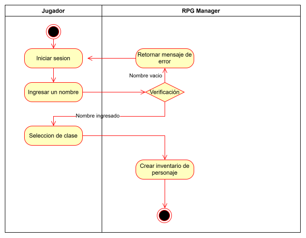

# Taller de Diagramas UML: Sistema RPG

Este repositorio contiene los diagramas UML diseñados para el modelado de un sistema de juego de rol (RPG), incluyendo el diagrama de contexto, el diagrama de casos de uso y los diagramas de actividades detallados para los flujos de combate.

---

## 📁 Estructura del Repositorio

```text
Taller-Diagramas/
├── diagramas-drawio/
│   ├── 01_contexto_rpg.drawio
│   ├── 01_contexto_rpg.svg
│   ├── 02_casos_uso_rpg.drawio
│   ├── 02_casos_uso_rpg.svg
│   ├── 03_actividades_combate.drawio   (2 páginas: CU-07 y CU-03)
│   ├── 03_actividades_cu07.svg
│   └── 03_actividades_cu03.svg
└── README.md
```

> 💡 **Nota:** Haz clic sobre cualquier diagrama para abrir el archivo vectorial SVG a tamaño completo.

---

## 🎨 Diagramas del Sistema

### 1. Diagrama de Contexto
Muestra las fronteras del sistema RPG y la interacción con los actores externos.

[](diagramas-drawio/01_contexto_rpg.svg)

---

### 2. Diagrama de Casos de Uso
Define las funcionalidades principales del sistema, actores e interacciones (`«include»`, `«extend»` y generalizaciones).

[](diagramas-drawio/02_casos_uso_rpg.svg)

---

### 3. Diagramas de Actividades

#### CU-07: Flujo de Combate
[](diagramas-drawio/03_actividades_cu07.svg)

#### CU-03: Gestión de Habilidades / Inventario de Combate
[](diagramas-drawio/03_actividades_cu03.svg)
